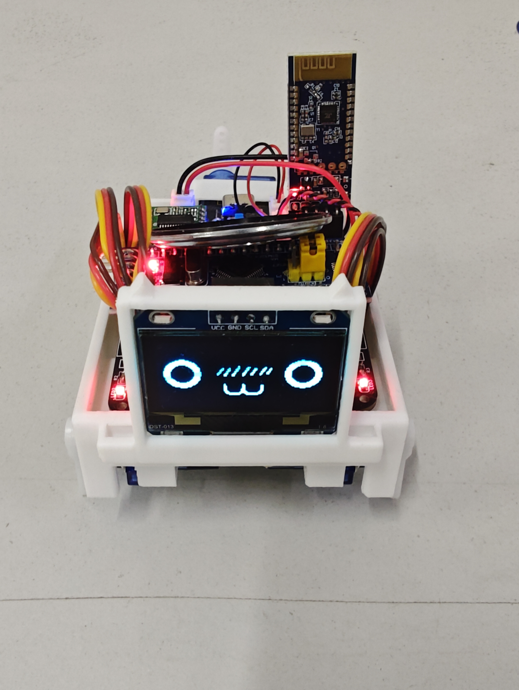
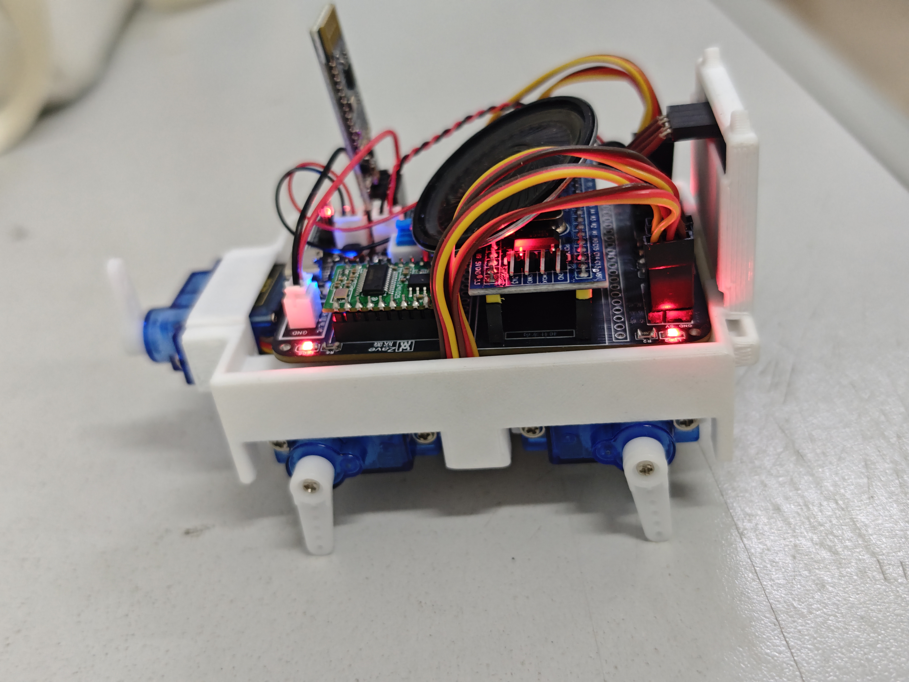
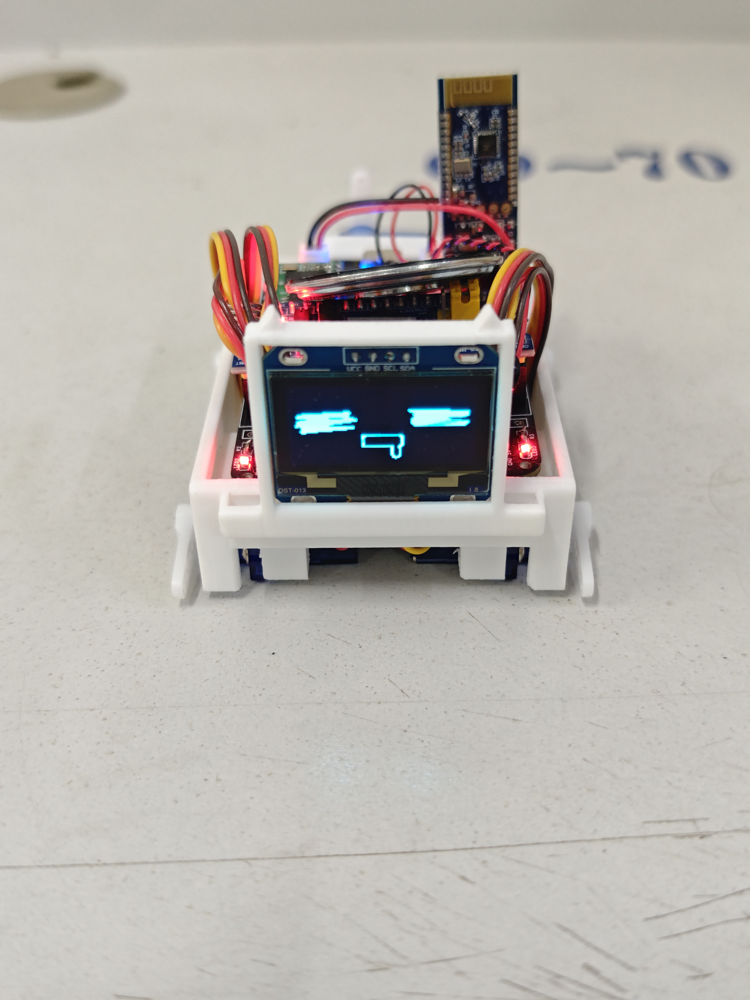
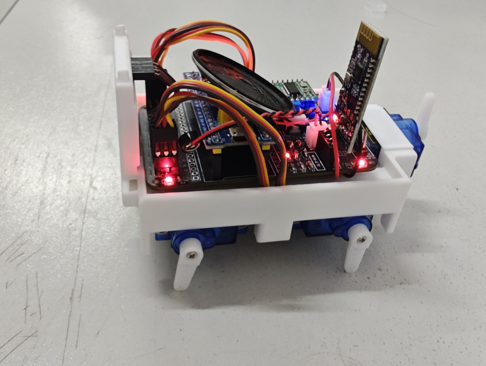
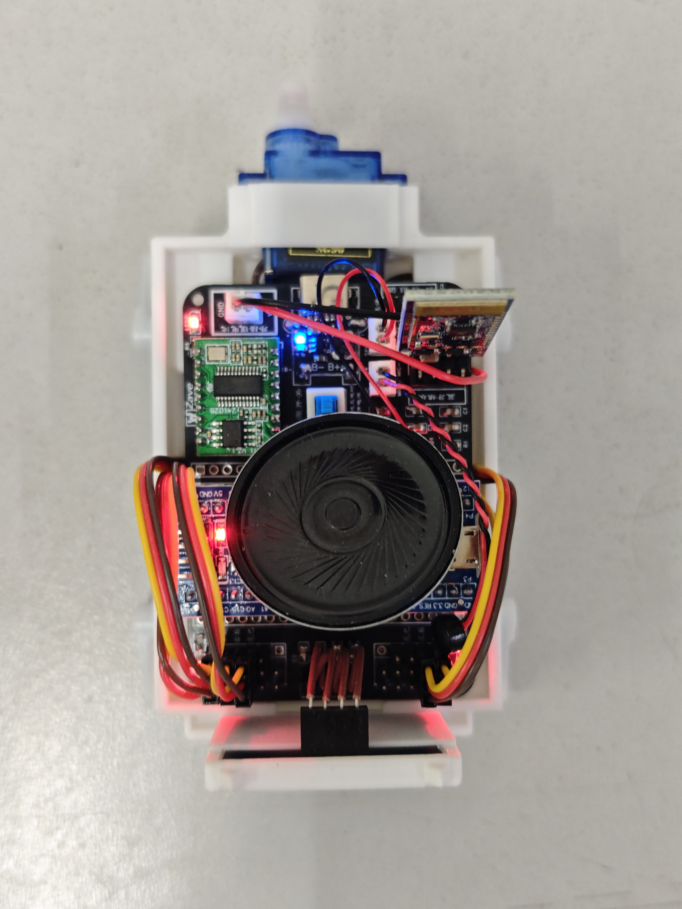
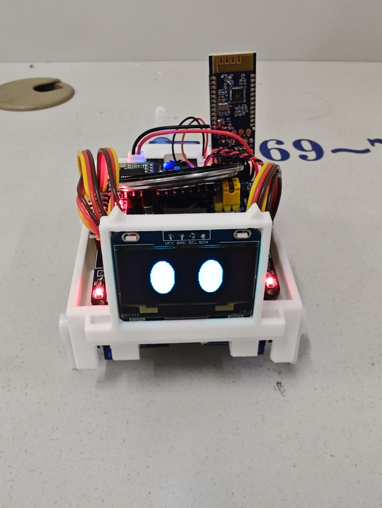
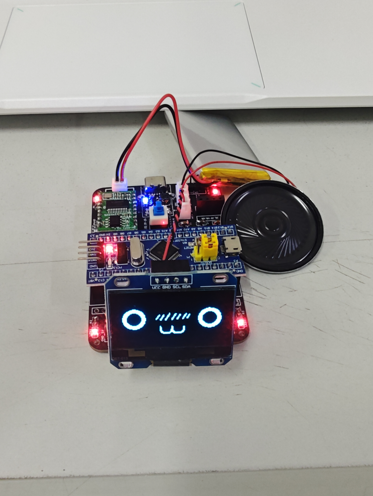
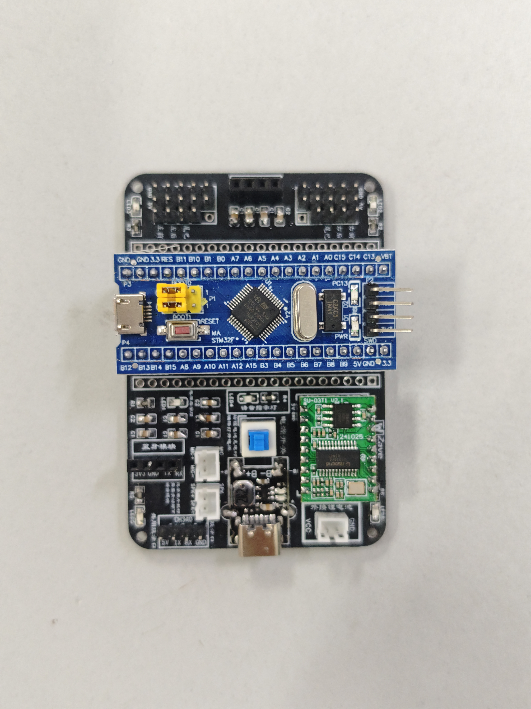
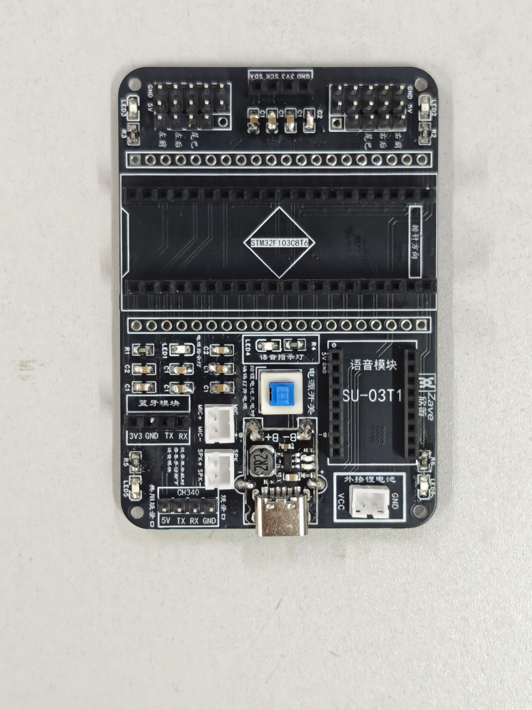
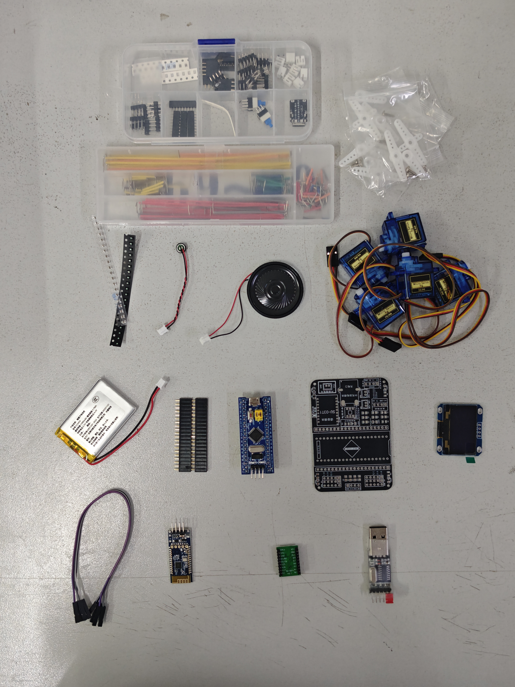

# STM32 Desktop Pet · 智能桌面宠物

> 一只住在你桌面上的电子宠物：基于 STM32F103C8T6，能走能跳、会摇尾巴、有 7 种表情，支持**离线语音控制**和**蓝牙控制**。



## 📺 演示视频

**功能演示**


**组装过程**


## ✨ 功能特性

- **16 种动作**：站立 / 趴下 / 坐下 / 前进 / 后退 / 左右转 / 摇摆 / 摇尾巴 / 前跳 / 后跳 / 打招呼 / 伸懒腰 / 后腿拉伸……
- **7 种表情**：睡觉、瞪大眼、快乐、狂热、非常快乐、眼睛、打招呼（128×64 OLED 点阵）
- **双通道交互**：
  - 🎙️ 离线语音控制（SU-03T1 语音模块，无需联网）
  - 📱 蓝牙控制（串口蓝牙模块）
- **氛围灯效**：双 LED 呼吸灯（TIM3 PWM 驱动，可开关 / 切换模式）
- **锂电池供电**，无线桌面摆放

## 📷 更多实拍

| 侧面结构 | 表情：哈欠 |
|---|---|
|  |  |

| 表情：圆眼 | 表情：眯眼 |
|---|---|
|  |  |

| 内部俯视（喇叭 / 电池 / 主板） | 裸板点亮 |
|---|---|
|  |  |

| PCB 正面 | PCB 背面（丝印） |
|---|---|
|  |  |

## 🔧 硬件组成

| 模块 | 型号 / 说明 |
|---|---|
| 主控 | STM32F103C8T6（Cortex-M3，72MHz） |
| 显示 | 0.96" OLED，128×64，I²C 接口 |
| 语音 | SU-03T1 离线语音识别模块（USART1，9600） |
| 蓝牙 | 串口蓝牙模块（USART3，9600） |
| 驱动 | 舵机 × 4（四肢）+ 舵机 × 1（尾巴），PWM 控制 |
| 灯效 | LED × 2（TIM3 PWM 呼吸灯） |
| 电源 | 锂电池 + Type-C 充电（CH340 串口下载） |

物料全家福：



## 📁 仓库结构

```
├── firmware/            # Keil MDK 工程源码
│   ├── User/            # 主程序 main.c、中断服务
│   ├── HardWare/        # 驱动层：OLED / 舵机 / 蓝牙 / 语音 / 表情 / 动作
│   ├── Library/         # STM32F10x 标准外设库
│   ├── Start/           # 启动文件 + system 时钟配置
│   └── release/         # 预编译 .hex 固件（免编译直接烧）
├── docs/                # 文档与素材
│   ├── flashing.md      # FlyMcu 串口烧录教程
│   └── images/          # 实拍照片、演示视频、组装视频
├── voice/               # 语音指令协议 + 词条配置说明
├── enclosure/           # 3D 打印外壳模型（STEP）
├── hardware/            # 原理图、BOM 物料清单
└── LICENSE              # MIT（含原作者致谢）
```

## 🚀 快速开始

1. **编译**（需要修改 / 定制固件时）
   - 安装 [Keil MDK 5](https://www.keil.com/)，通过 Pack Installer 安装 `Keil.STM32F1xx_DFP 2.2.0`
   - 打开 `firmware/Project.uvprojx`，编译生成 `.hex`
2. **烧录**（零基础，5 分钟）
   - 按 [docs/flashing.md](docs/flashing.md)：CH340 + FlyMcu 串口烧录
   - 懒人方案：直接烧 `firmware/release/` 里的预编译固件
3. **语音控制**
   - 按 [voice/su-03t1-commands.md](voice/su-03t1-commands.md) 查看指令协议，可在智能公元平台自定义唤醒词 / 命令词

## 🖨️ 3D 打印外壳

- 模型文件：[`enclosure/pet-enclosure-v1.9.step`](enclosure/pet-enclosure-v1.9.step)（STEP 通用格式，SolidWorks / Fusion 360 / 切片软件均可导入）
- 该版本已通过**厚壁检测**（最小壁厚满足常见 FDM 打印要求），建议 0.2mm 层高、15%~20% 填充

## 🧩 组装过程

组装视频见上方「演示视频 - 组装过程」，物料清点见[物料全家福](docs/images/materials.jpg)。

## 🗺️ Roadmap & Known Issues

> 复刻作品，持续打磨中：
> - [ ] 补充原理图与 BOM（从立创开源平台导出后归档）
> - [ ] 整理代码已知问题清单与重构思路
> - [ ] 增加更多表情 / 动作（可选）

## 🙏 致谢

- 本项目为**复刻作品**，原型来自 **Sngels_wyh** 的开源项目《基于STM32F103C8T6单片机的桌面宠物小项目》：
  <https://oshwhub.com/sngelswyh/stm32-smart-desktop-pet>
  作者声明可任意查看、使用、修改，特此致谢。
- STM32F10x 标准外设库 © STMicroelectronics

## 📄 License

[MIT](LICENSE) © 2026 LIU20071212（遵循原项目共享声明）
